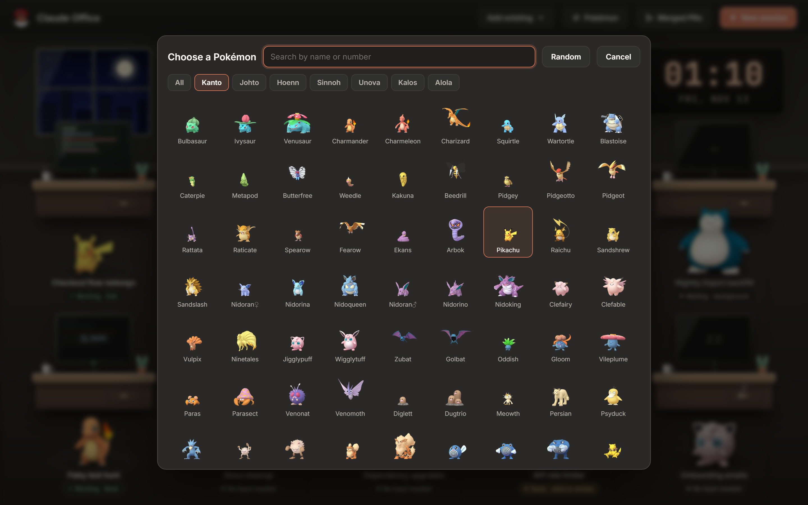
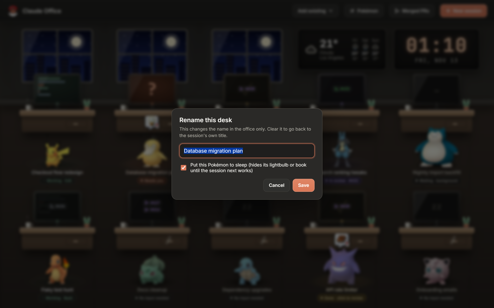

# Claude Pocket

**Every Claude Code session on your PC, as a Pokémon or MapleStory monster at a desk.**

Claude Pocket is a local dashboard that shows what each of your Claude Code sessions is doing right
now: which ones are working, which one is waiting on you, and which have finished. Glance at the
room instead of clicking through sessions.


It runs entirely on your machine. One Python file, one HTML page, no dependencies to install and no
build step.

## Contents

- [What a desk tells you](#what-a-desk-tells-you)
- [Features](#features)
- [Quick start](#quick-start)
- [Uninstall](#uninstall)
- [How it works](#how-it-works)
- [Requirements](#requirements)
- [Known limits](#known-limits)
- [Settings](#settings)
- [Project layout](#project-layout)

## What a desk tells you

| Desk | Meaning | What to do |
|---|---|---|
| Typing screen, green chip | The session is working | Nothing |
| **Lightbulb** | It ended its turn on a question, or needs a permission | Answer it |
| **Book** | It finished, or its pull request was approved or merged | Review the result |
| Purple, "In review · #123" | It finished and its pull request is waiting for review | Nothing yet |
| "Waiting · background" | It stopped only to wait on its own background job | Nothing |
| Grey, "z"s | Nothing for you to do | Nothing |

The browser tab title carries the same signal, so you can tell from a pinned tab whether anything
needs you: `(1) 💡 Claude Pocket` or `(2) 📖 Claude Pocket`.

You can hear it too: the page plays MapleStory's quest alert when a desk raises a lightbulb and its
invite chime when a desk raises a book. Desks already showing one when the page opens stay quiet,
and so do asleep desks. In a browser tab, sound is only allowed once you have clicked the page after
it loads; the office's own window plays it straight away.

## Features

### An app that stays in the tray

The office opens in a window of its own, with no tabs or address bar, and puts an icon in the
Windows notification area (the tray). Closing the window does not stop the office: sessions keep
reporting to it, meeting reminders still pop up and your phone can still open it. Click the tray icon
to bring the window back, or right-click it for **Open** and **Quit**.

The window is Chrome in app mode, or Edge when Chrome is not installed. It opens maximized the first
time and afterwards wherever you left it. It keeps its own browser settings, so it asks once for your
location (for the weather); without it the weather is for the city your time zone is named after.
<http://localhost:4545> still works in any browser tab.

### Open a session with one click

Click a desk to bring that session to the front in the Claude desktop app. Drag desks to reorder
the room. **Add existing** puts a session from the app onto a desk, and **New session** starts one.

### Two casts

The theme button in the header switches the whole office between Pokémon and MapleStory monsters.
Every desk keeps one of each, so switching back and forth never loses a pick.


### Pull requests on the desk

A desk's screen lists the pull requests that session opened, coloured by status (draft, open,
merged, closed). When a session finishes while its pull request is still waiting for review, the
desk holds back the book and shows **In review**; the book appears once the pull request is
approved or merged.

### Merged PRs, with credit where it's due

The **Merged PRs** button lists the pull requests you have merged, newest first and grouped by day,
each with the character whose session opened it.


### To-do list

The **To-do** button next to the office name opens a simple list: type to add an item, tick it when
it is done, and use × to remove it. The button shows how many are still open, and the list is the
same on the computer and your phone.

### Meeting reminders

The calendar button next to the to-do list reads your own Outlook calendar, which includes your
Teams meetings. It works with any Microsoft 365 work or school account whose organisation allows
calendar publishing. It shows your next meeting, and 10, 5 and 1 minutes before each one a reminder pops up
that stays, with an alarm ringing, until you press **Got it**. The reminder appears in two places:
in a small window on top of every other window on the computer (even with the browser closed), and
as a banner in the office page (so your phone sees it too). Pressing **Got it** in either place
clears both. On this computer the window rings the alarm, and on a phone the page does, once the
page has been tapped since it was opened (browsers allow no sound before that). A muted computer
stays silent. **Join in Teams** opens the meeting and also counts as Got it. The alarm is Windows'
own `Alarm01.wav`.

To set it up, publish your calendar in Outlook on the web:

1. Open Outlook on the web, select **Settings** (the gear), then **Calendar** → **Shared calendars**.
2. Under **Publish a calendar**, choose **Calendar** and **Can view all details**, then **Publish**.
3. Copy the **ICS** link.
4. In the office, open the calendar button, paste the link and press **Save**. The box goes away once
   the calendar has been read, and comes back only if the link stops working.

The office reads the calendar once a minute. Microsoft refreshes a published calendar on its own
schedule, so a meeting added in the last few minutes may not show up yet. Anyone who has the link can
read your calendar, so the office keeps it in `calendar-link.txt`, which is not in git. If your
organisation has turned off calendar publishing, step 2 has no **Publish** option.

### Choose your team

Right-click a desk to pick its Pokémon from 809, filtered by region or searched by name or number.
**Random** picks one for you from whatever is shown. Pokémon are drawn to scale with each other, so
an Azurill is smaller than a Reshiram.

In MapleStory mode the same picker offers 452 monsters: the classic pre-Big Bang ones plus the main
bosses added since, grouped by level.



### Rename and mute

The pencil on a desk renames it in the office (the session's own title is left alone). The same
dialog can put a character to sleep, which hides its lightbulb or book until that session next does
any work.



### Stock widget

The header can show a small watchlist of stocks with live prices; clicking one opens a price graph
with ranges from one day to all time. It is off by default; set `"stocks": true` in `office.json`
to turn it on. Taiwan codes (such as `2330`) use the Taiwan exchange's feed, everything else
(such as `AAPL`) Yahoo Finance.

## Quick start

Windows only. Each step is something you do once.

1. **Install Python 3** if you don't have it. In PowerShell:

   ```powershell
   winget install Python.Python.3.12
   ```

   Or use the installer from [python.org](https://www.python.org/downloads/) and tick
   **Add python.exe to PATH**. Open a new PowerShell window afterwards.

2. **Install Claude and sign in.** Install the [Claude desktop app](https://claude.ai/download)
   (or Claude Code), sign in with your own account, open the **Code** tab and start one session.
   Claude Pocket reads nothing from your account; it only listens to the sessions on this PC.

3. **Get this folder.** Either `git clone` this repository, or use **Code → Download ZIP** on GitHub
   and unzip it somewhere that stays put, such as `Documents\claude-pocket`.

4. **Run the installer** from that folder:

   ```powershell
   powershell -ExecutionPolicy Bypass -File .\install.ps1
   ```

   It checks for Python and Claude, copies `hooks\office_hook.py` into your `.claude\hooks` folder,
   adds it to your Claude `settings.json` (keeping everything else there, with a backup in
   `settings.json.bak`) and starts the office. Add `-Startup` to also start it when you sign in to
   Windows. Running it again is safe.

5. **Send a message in any Claude Code session.** Its character walks in.

Optional:

- **Pull requests on desks.** Install the [GitHub CLI](https://cli.github.com/)
  (`winget install GitHub.cli`) and run `gh auth login` with your own GitHub account.
- **Meeting reminders.** Paste your Outlook calendar link into the calendar button, see
  [Meeting reminders](#meeting-reminders).
- **Weather.** The office window asks once for your location; without it, the weather is for the
  city your time zone is named after.
- **Stocks or your phone.** See [Settings](#settings).

To start the office later, double-click `Start Claude Pocket.vbs`. Double-clicking it while the
office is running just brings the window back. To stop it, right-click the tray icon and choose
**Quit**.

## Uninstall

```powershell
powershell -ExecutionPolicy Bypass -File .\install.ps1 -Uninstall
```

This takes the hook out of your Claude settings and removes the Startup shortcut. Then quit the
office from its tray icon and delete the folder.

## How it works

```
Claude Code session ──hook event──▶ office_hook.py ──POST /event──▶ server.py ◀──poll /state── index.html
```

- **The hook** forwards each Claude Code event to the server on `127.0.0.1:4545`. It gives up
  silently after 0.3 seconds, so sessions are unaffected when the office is not running.
- **The server** keeps one record per session and works out its desk state from the events: a turn
  that ends on a question becomes a lightbulb, one that ends with nothing asked becomes a book.
  Background loops match sessions to the desktop app's records, check pull request status through
  the `gh` command, and read session transcripts to learn which session opened which pull request.
- **The page** polls the server every second and draws the room. All styling and script are inline.

Nothing leaves your machine except the requests the page and server make for public data: character
sprites, fonts, the weather, and your own pull requests through `gh`.

[NOTES.md](NOTES.md) covers the internals in detail, including the parts that rely on undocumented
app behaviour and may break on an update.

## Requirements

- Windows 10 or 11, with the Claude desktop app or Claude Code
- Python 3 (standard library only, nothing to `pip install`)
- Chrome or Edge, for the office's own window
- Optional: the [GitHub CLI](https://cli.github.com/) (`gh`), signed in, for pull request status
  on desks and the Merged PRs panel

## Known limits

- Cloud sessions never appear, because hooks only run on the PC where the office is.
- Sprites, fonts and weather need an internet connection.
- Renaming a desk does not rename the session in the Claude app.
- A pull request shows on a desk only if the session opened it with `gh pr create`.
- Opening a session from a desk relies on the Claude desktop app's `claude://` links.
- MapleStory sprites come from a community-run service; if it is down, those desks show a placeholder.

## Settings

`office.json` holds the settings. Edit it, then quit the office from the tray and start it again.

| Key | Default | What it does |
|---|---|---|
| `name` | `"Claude Pocket"` | The name in the header, the window title and the tray |
| `themes` | `["pokemon", "maple"]` | Which casts the theme button offers; list one to hide the button |
| `stocks` | `false` | The header stock widget |
| `lan` | `false` | Lets your phone open the office over your Wi-Fi, using a private key |

With `"lan": true` the office writes the phone's address, key included, to `phone-link.txt` on
start. Windows Firewall asks once to allow Python on private networks.

## Project layout

| Path | What it is |
|---|---|
| `server.py` | The office server (port 4545) |
| `meetings.py` | Reads your published calendar and shows the meeting reminders |
| `sounds.py` | Fetches the two MapleStory sounds the desks play |
| `tray.py` | The tray icon, and the office's own window |
| `index.html` | The page: markup, styles and script in one file |
| `office.json` | Settings, see [Settings](#settings) |
| `install.ps1` | Installs (or with `-Uninstall` removes) the hook, and starts the office |
| `hooks/office_hook.py` | The hook script to copy into `.claude/hooks` |
| `Start Claude Pocket.vbs` | Launcher for Windows |
| `maple.json` | The MapleStory monster list |
| `icon.png`, `icon.svg` | The app's icon (tray and page) |
| `markers/` | The lightbulb and book marker animations; drop in your own to replace them |
| `NOTES.md` | How it all works, for whoever changes it next |

While it runs, the office writes `state.json`, `hidden.json`, `credits.json`, `merged.json`,
`todos.json`, `settings.json`, `stocks.json`, `calendar-link.txt`, `meeting-acks.json`, `lan-key.txt`,
`phone-link.txt`, `sounds/` and `clicks.log` next to the server. They hold your session data, are ignored by
git, and are safe to delete.
