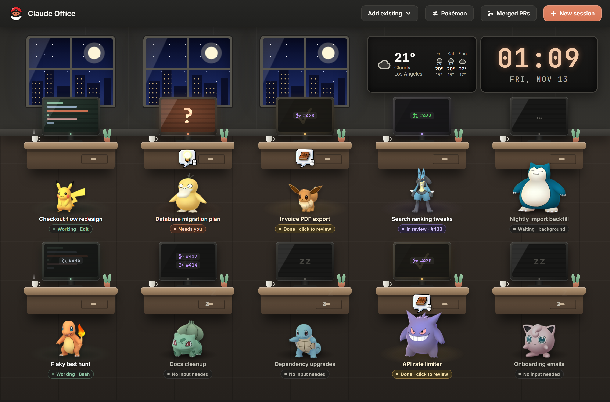
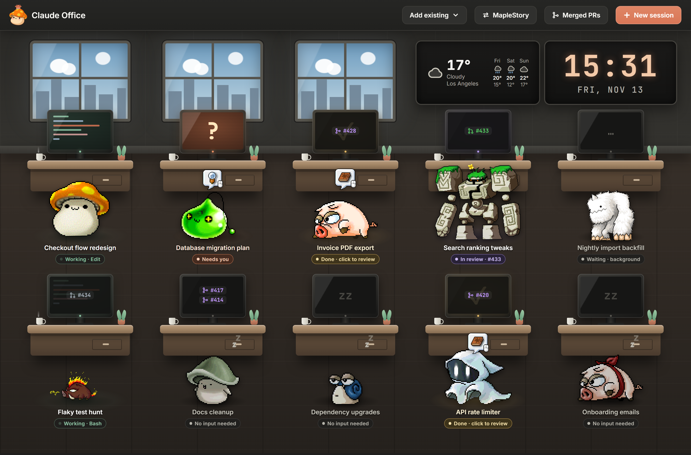
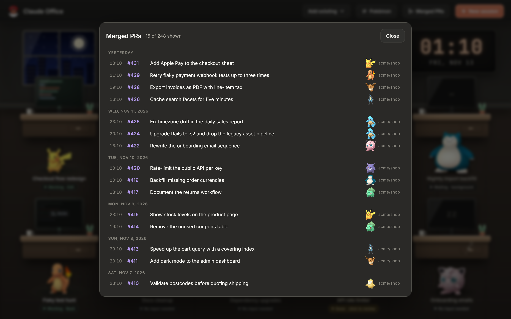

# Claude Pocket

**Every Claude Code session on your computer, as a Pokémon or MapleStory monster at a desk.**

Claude Pocket is a local dashboard that shows what each of your Claude Code sessions is doing right
now: which ones are working, which one is waiting on you, and which have finished. Glance at the
room instead of clicking through sessions.



It runs entirely on your machine. One Python file, one HTML page, no dependencies to install and no
build step.

## Install

You need the [Claude desktop app](https://claude.ai/download) (or Claude Code) installed and signed in
to your own account. Claude Pocket runs on **Windows 10 or 11** and on **macOS** (Mac support is new:
see [Known limits](#known-limits)).

**Ask Claude.** In Claude Code, or the **Code** tab of the Claude desktop app, say:

> install this for me https://github.com/yuiya-dev/claude-pocket

Claude follows [the steps below](#instructions-for-claude-and-other-ai-assistants), asks before
installing anything extra such as Python, and tells you when the office is running.

**Or with one command.**

- **Windows:** open PowerShell (Start menu → type `PowerShell`) and paste:

  ```powershell
  irm https://raw.githubusercontent.com/yuiya-dev/claude-pocket/main/get.ps1 | iex
  ```

- **Mac:** open Terminal (Spotlight → type `Terminal`) and paste:

  ```bash
  curl -fsSL https://raw.githubusercontent.com/yuiya-dev/claude-pocket/main/get.sh | bash
  ```

**Or download it.** [Download the ZIP](https://github.com/yuiya-dev/claude-pocket/archive/refs/heads/main.zip)
and unzip it somewhere that stays put (such as `Documents`). Then open the folder and double-click
**`Install.cmd`** on Windows, or **`Install.command`** on a Mac. The first time, macOS may say it
can't check that file: right-click it, choose **Open**, then **Open** again.

Every way runs the same installer. It checks for Python (and offers to install it if it's missing),
connects Claude Pocket to your Claude, adds a **Claude Pocket** shortcut (Start menu and desktop on
Windows, `~/Applications` on a Mac) and opens the office. Then send a message in any Claude Code
session and its character walks in. [Quick start](#quick-start) has the details, and how to update or
remove it.

### Instructions for Claude and other AI assistants

A user has asked you to install Claude Pocket on their computer. It runs on Windows 10 or 11 and on
macOS, and you can only install it where you can run commands (Claude Code, or the Code tab in the
Claude desktop app). In a plain chat with no command access, give the user the one-command install
above instead.

1. **Check the system.** On Windows, `$env:OS` in PowerShell is `Windows_NT`; on a Mac, `uname` prints
   `Darwin`. On anything else (Linux, ChromeOS), stop and tell the user Claude Pocket runs on Windows
   and macOS only. Then follow the steps for that system.
2. **Check Python 3.**
   - Windows: run `py -3 --version`, then `python --version` if that fails.
   - Mac: run `python3 --version`. (On a Mac without developer tools, `python3` can pop up an
     install dialog; that counts as missing.)

   If neither prints `Python 3.x`, ask the user: *"Claude Pocket needs Python 3. May I install it?"*
   (on Windows with winget, on a Mac with Homebrew if `brew` exists). Add the yes option below only if
   they agree. Without it, the installer stops when Python is missing rather than install it. On a
   Mac without Homebrew, ask the user to install Python from python.org, then continue.
3. **Tell the user what will change, then install.** The installer copies one hook script,
   `claude_pocket_hook.py`, into the `.claude/hooks` folder in their home folder and adds it to
   `.claude/settings.json` there. It keeps every other setting, and keeps a copy from before the
   first install as `settings.json.claude-pocket.bak`. It installs the app (Windows:
   `%LOCALAPPDATA%\Programs\Claude Pocket`; Mac: `~/Library/Application Support/Claude Pocket`), adds a
   **Claude Pocket** shortcut and opens the office. Do not edit `settings.json` yourself; the
   installer does it safely.

   **Windows**, in PowerShell:

   ```powershell
   $env:CLAUDE_POCKET_ARGS = "-Yes"   # only if the user agreed to install Python; otherwise leave this line out
   irm https://raw.githubusercontent.com/yuiya-dev/claude-pocket/main/get.ps1 | iex
   ```

   From Git Bash on Windows, use single quotes so Bash leaves the `$` alone (start the quoted command
   with `$env:CLAUDE_POCKET_ARGS="-Yes"; ` if the user agreed):

   ```bash
   powershell.exe -NoProfile -ExecutionPolicy Bypass -Command 'irm https://raw.githubusercontent.com/yuiya-dev/claude-pocket/main/get.ps1 | iex'
   ```

   **Mac**, in a shell (add `--yes` at the end only if the user agreed to install Python):

   ```bash
   curl -fsSL https://raw.githubusercontent.com/yuiya-dev/claude-pocket/main/get.sh | bash -s --
   ```

   `get.ps1`, `install.ps1`, `get.sh` and `install.sh` are short and safe to read first. If you would
   rather not pipe a download into a shell, `git clone https://github.com/yuiya-dev/claude-pocket` into
   the app folder named above and run its installer there: `install.ps1` (with `-Yes` if agreed) on
   Windows, `bash install.sh` (with `--yes` if agreed) on a Mac.
4. **Read the output.** Success prints green `Python:`, `Claude:`, `Hook:` and `Settings:` lines.
   A red message means it stopped; tell the user what it says.
5. **Check it is running.** Within about 10 seconds, `http://127.0.0.1:4545/config` answers with
   `"name": "Claude Pocket"` (`Invoke-RestMethod` on Windows, `curl -s` on a Mac). If it already
   answered with some other name before you installed, another app is using that port: tell the user.
6. **Tell the user:** the office is open (Windows: in its own window; Mac: in the browser); they can
   reopen it any time from the **Claude Pocket** shortcut; their sessions appear at desks after their
   next message (if one doesn't, restart that session); and to remove it, run the installer from the
   app folder with `-Uninstall` (Windows) or `--uninstall` (Mac). Optional extras are the GitHub CLI
   (`gh auth login`) for pull requests on desks and the calendar button for Outlook/Teams meeting
   reminders.

## Contents

- [What a desk tells you](#what-a-desk-tells-you)
- [Features](#features)
- [Install](#install)
  - [Instructions for Claude and other AI assistants](#instructions-for-claude-and-other-ai-assistants)
- [Quick start](#quick-start)
- [Update](#update)
- [Uninstall](#uninstall)
- [How it works](#how-it-works)
- [Requirements](#requirements)
- [Known limits](#known-limits)
- [Settings](#settings)
- [Project layout](#project-layout)
- [License](#license)

## What a desk tells you

| Desk | Meaning | What to do |
|---|---|---|
| Typing screen, green chip | The session is working | Nothing |
| **Lightbulb** | It ended its turn on a question, or needs a permission | Answer it |
| **Book** | It finished, or its pull request was approved or merged | Review the result |
| Purple, "In review · #123" | It finished and its pull request is waiting for review | Nothing yet |
| "Waiting · background" | It stopped only to wait on its own background job | Nothing |
| Grey, "z"s | Nothing for you to do | Nothing |

The browser tab title carries the same signal, so you can tell from a pinned tab whether anything
needs you: `(1) 💡 Claude Pocket` or `(2) 📖 Claude Pocket`.

You can hear it too: the page plays MapleStory's quest alert when a desk raises a lightbulb and its
invite chime when a desk raises a book. Desks already showing one when the page opens stay quiet,
and so do asleep desks. In a browser tab, sound is only allowed once you have clicked the page after
it loads; the office's own window plays it straight away.

## Features

### An app that stays in the tray

The office opens in a window of its own, with no tabs or address bar, and puts an icon in the
Windows notification area (the tray). Closing the window does not stop the office: sessions keep
reporting to it, meeting reminders still pop up and your phone can still open it. Click the tray icon
to bring the window back, or right-click it for **Open** and **Quit**.

The window is Chrome in app mode, or Edge when Chrome is not installed. It opens maximized the first
time and afterwards wherever you left it. It keeps its own browser settings, so it asks once for your
location (for the weather); without it the weather is for the city your time zone is named after.
<http://localhost:4545> still works in any browser tab.

On a Mac there is no tray icon or window of its own: the office opens as a tab in your default
browser. Reopen it with the **Claude Pocket** app, and stop it with `claude-pocket stop` (see
[Quick start](#quick-start)).

### Open a session with one click

Click a desk to bring that session to the front in the Claude desktop app. Drag desks to reorder
the room. **Add existing** puts a session from the app onto a desk, and **New session** starts one.

### Two casts

The theme button in the header switches the whole office between Pokémon and MapleStory monsters.
Every desk keeps one of each, so switching back and forth never loses a pick.



### Pull requests on the desk

A desk's screen lists the pull requests that session opened, coloured by status (draft, open,
merged, closed). When a session finishes while its pull request is still waiting for review, the
desk holds back the book and shows **In review**; the book appears once the pull request is
approved or merged.

### Merged PRs, with credit where it's due

The **Merged PRs** button lists the pull requests you have merged, newest first and grouped by day,
each with the character whose session opened it.



### To-do list

The **To-do** button next to the office name opens a simple list: type to add an item, tick it when
it is done, and use × to remove it. The button shows how many are still open, and the list is the
same on the computer and your phone.

### Meeting reminders

The calendar button next to the to-do list reads your own Outlook calendar, which includes your
Teams meetings. It works with any Microsoft 365 work or school account whose organisation allows
calendar publishing. It shows your next meeting, and 10, 5 and 1 minutes before each one a reminder pops up
that stays, with an alarm ringing, until you press **Got it**. The reminder appears in two places:
in a small window on top of every other window on the computer (even with the browser closed), and
as a banner in the office page (so your phone sees it too). Pressing **Got it** in either place
clears both. On this computer the window rings the alarm, and on a phone the page does, once the
page has been tapped since it was opened (browsers allow no sound before that). A muted computer
stays silent. **Join in Teams** opens the meeting and also counts as Got it. The alarm is Windows'
own `Alarm01.wav`; on a Mac the reminder is a macOS dialog and the alarm is the system's Sosumi sound.

To set it up, publish your calendar in Outlook on the web:

1. Open Outlook on the web, select **Settings** (the gear), then **Calendar** → **Shared calendars**.
2. Under **Publish a calendar**, choose **Calendar** and **Can view all details**, then **Publish**.
3. Copy the **ICS** link.
4. In the office, open the calendar button, paste the link and press **Save**. The box goes away once
   the calendar has been read, and comes back only if the link stops working.

The office reads the calendar once a minute. Microsoft refreshes a published calendar on its own
schedule, so a meeting added in the last few minutes may not show up yet. Anyone who has the link can
read your calendar, so the office keeps it in `calendar-link.txt`, which is not in git. If your
organisation has turned off calendar publishing, step 2 has no **Publish** option.

### Choose your team

Right-click a desk to pick its Pokémon from 809, filtered by region or searched by name or number.
**Random** picks one for you from whatever is shown. Pokémon are drawn to scale with each other, so
an Azurill is smaller than a Reshiram.

In MapleStory mode the same picker offers 452 monsters: the classic pre-Big Bang ones plus the main
bosses added since, grouped by level.


### Rename and mute

The pencil on a desk renames it in the office (the session's own title is left alone). The same
dialog can put a character to sleep, which hides its lightbulb or book until that session next does
any work.


### Stock widget

The header can show a small watchlist of stocks with live prices; clicking one opens a price graph
with ranges from one day to all time. It is off by default; set `"stocks": true` in `office.json`
to turn it on. Taiwan codes (such as `2330`) use the Taiwan exchange's feed, everything else
(such as `AAPL`) Yahoo Finance.

## Quick start

What the installer does, step by step, and what to do if something stops it.

1. **Claude.** Install the [Claude desktop app](https://claude.ai/download) (or Claude Code), sign
   in with your own account, open the **Code** tab and start one session. Claude Pocket reads
   nothing from your account; it only listens to the sessions on this computer. If Claude has never
   run, the installer stops and says so.

2. **Python 3.** If it is missing, the installer asks to install it: with `winget` on Windows, with
   [Homebrew](https://brew.sh) on a Mac. Say **Y**. Otherwise install Python from
   [python.org](https://www.python.org/downloads/) (on Windows, tick **Add python.exe to PATH**) and
   run the installer again.

3. **The hook.** The installer copies `hooks/claude_pocket_hook.py` into the `.claude/hooks` folder
   in your home folder and adds it to your Claude `settings.json`, keeping everything else there.
   Your settings from before the first install are kept as `settings.json.claude-pocket.bak`. This
   is how sessions report to the office.

4. **Shortcuts.** On Windows, **Claude Pocket** goes into the Start menu and onto the desktop. On a
   Mac it goes into `~/Applications`, where Spotlight and Launchpad find it.

5. **Send a message in any Claude Code session.** Its character walks in. Sessions that were already
   open show up after their next message; if one doesn't, restart that session.

Installer options, run from the app's folder:

| Windows (`install.ps1`) | Mac (`install.sh`) | What it does |
|---|---|---|
| `-Startup` | `--startup` | Also start the office when you sign in |
| `-NoDesktop` | `--no-app` | No desktop shortcut (Windows) / no app in `~/Applications` (Mac) |
| `-Yes` | `--yes` | Install Python without asking, if it is missing |
| `-Uninstall` | `--uninstall` | Remove the hook, the shortcuts and the login item |

For example `powershell -ExecutionPolicy Bypass -File .\install.ps1 -Startup` on Windows, or
`bash install.sh --startup` on a Mac. With the one-command install, pass them like this:

```powershell
$env:CLAUDE_POCKET_ARGS = "-Startup"
irm https://raw.githubusercontent.com/yuiya-dev/claude-pocket/main/get.ps1 | iex
```

```bash
curl -fsSL https://raw.githubusercontent.com/yuiya-dev/claude-pocket/main/get.sh | bash -s -- --startup
```

The one-command install puts the app in `%LOCALAPPDATA%\Programs\Claude Pocket` (Windows) or
`~/Library/Application Support/Claude Pocket` (Mac); the ZIP install leaves it where you unzipped
it. Running the installer again is always safe.

Optional:

- **Pull requests on desks.** Install the [GitHub CLI](https://cli.github.com/)
  (`winget install GitHub.cli`, or `brew install gh`) and run `gh auth login` with your own GitHub
  account.
- **Meeting reminders.** Paste your Outlook calendar link into the calendar button, see
  [Meeting reminders](#meeting-reminders).
- **Weather.** The page asks once for your location; without it, the weather is for the city your
  time zone is named after.
- **Stocks or your phone.** See [Settings](#settings).

To open the office later, use the **Claude Pocket** shortcut. Opening it while the office is running
just brings it back. To stop it: on Windows, right-click the tray icon and choose **Quit**; on a Mac,
run `claude-pocket stop` from the app's folder:

```bash
~/"Library/Application Support/Claude Pocket/claude-pocket" stop
```

The same script also takes `start`, `status`, or nothing (open the office).

## Update

Run the one-line command again. It downloads the latest version over the old one and keeps your
`office.json` and everything the office has saved. With a ZIP install, download the new ZIP, unzip it
over the old folder (keep your `office.json` if you changed it) and run the installer again.

## Uninstall

From the app's folder:

```powershell
powershell -ExecutionPolicy Bypass -File .\install.ps1 -Uninstall
```

```bash
bash install.sh --uninstall
```

It takes the hook out of your Claude settings and removes the shortcuts (and on a Mac the app and
the login item, and stops the office). On Windows, quit the office from its tray icon. Then delete
the folder.

## How it works

```
Claude Code session ──hook event──▶ claude_pocket_hook.py ──POST /event──▶ server.py ◀──poll /state── index.html
```

- **The hook** forwards each Claude Code event to the server on `127.0.0.1:4545`. It gives up
  silently after 0.3 seconds, so sessions are unaffected when the office is not running.
- **The server** keeps one record per session and works out its desk state from the events: a turn
  that ends on a question becomes a lightbulb, one that ends with nothing asked becomes a book.
  Background loops match sessions to the desktop app's records, check pull request status through
  the `gh` command, and read session transcripts to learn which session opened which pull request.
- **The page** polls the server every second and draws the room. All styling and script are inline.

Nothing leaves your machine except the requests the page and server make for public data: character
sprites, fonts, the weather, and your own pull requests through `gh`.

[NOTES.md](NOTES.md) covers the internals in detail, including the parts that rely on undocumented
app behaviour and may break on an update.

## Requirements

- Windows 10 or 11, or macOS, with the Claude desktop app or Claude Code
- Python 3 (standard library only, nothing to `pip install`)
- Windows: Chrome or Edge, for the office's own window. Mac: any browser
- Optional: the [GitHub CLI](https://cli.github.com/) (`gh`), signed in, for pull request status
  on desks and the Merged PRs panel

## Known limits

- **Mac support is new and has not yet been tried on a real Mac.** The office, desks, sounds and
  meeting reminders should work. Two parts depend on where the Claude desktop app keeps its records
  on a Mac, which is not confirmed: desks may show your first message instead of the session's
  title, and **Add existing** and clicking a desk may not find the session. Please report what you
  see.
- On a Mac, clicking a desk opens the session with the app's link but does not repair a window that
  keeps showing the old session (the Windows fix uses Windows functions).
- Cloud sessions never appear, because hooks only run on the computer where the office is.
- Sprites, fonts and weather need an internet connection.
- Renaming a desk does not rename the session in the Claude app.
- A pull request shows on a desk only if the session opened it with `gh pr create`.
- Opening a session from a desk relies on the Claude desktop app's `claude://` links.
- MapleStory sprites come from a community-run service; if it is down, those desks show a placeholder.

## Settings

`office.json` holds the settings. Edit it, then stop the office and start it again.

| Key | Default | What it does |
|---|---|---|
| `name` | `"Claude Pocket"` | The name in the header, the window title and the tray |
| `themes` | `["pokemon", "maple"]` | Which casts the theme button offers; list one to hide the button |
| `stocks` | `false` | The header stock widget |
| `lan` | `false` | Lets your phone open the office over your Wi-Fi, using a private key |

With `"lan": true` the office writes the phone's address, key included, to `phone-link.txt` on
start. Windows Firewall (or the macOS firewall, if it is on) asks once to allow Python.

## Project layout

| Path | What it is |
|---|---|
| `server.py` | The office server (port 4545) |
| `meetings.py` | Reads your published calendar and shows the meeting reminders |
| `sounds.py` | Fetches the two MapleStory sounds the desks play |
| `tray.py` | The tray icon and the office's own window (Windows); opening the browser (Mac) |
| `index.html` | The page: markup, styles and script in one file |
| `office.json` | Settings, see [Settings](#settings) |
| `install.ps1` | Installs (or with `-Uninstall` removes) the hook and shortcuts, and starts the office |
| `Install.cmd` | Double-click to run `install.ps1` |
| `get.ps1` | The one-command download and install |
| `hooks/claude_pocket_hook.py` | The hook script to copy into `.claude/hooks` |
| `Start Claude Pocket.vbs` | Launcher for Windows |
| `install.sh`, `Install.command`, `get.sh` | The same three for macOS |
| `claude-pocket` | Mac launcher: open, `start`, `stop`, `status` |
| `pocket_hooks.py` | Adds or removes the hook in Claude's `settings.json` (used by `install.sh`) |
| `maple.json` | The MapleStory monster list |
| `icon.png`, `icon.svg`, `icon.ico` | The app's icon (tray, page and shortcuts) |
| `markers/` | The lightbulb and book marker animations; drop in your own to replace them |
| `NOTES.md` | How it all works, for whoever changes it next |

While it runs, the office writes `state.json`, `hidden.json`, `credits.json`, `merged.json`,
`todos.json`, `settings.json`, `stocks.json`, `calendar-link.txt`, `meeting-acks.json`, `lan-key.txt`,
`phone-link.txt`, `python-path.txt`, `sounds/` and `clicks.log` next to the server. They hold your session data, are ignored by
git, and are safe to delete.

## License

[MIT](LICENSE): use it, change it and share it freely.

That covers this project's own code and files. Pokémon and MapleStory, their characters and the two
MapleStory sounds belong to their owners (Nintendo, Game Freak and The Pokémon Company; Nexon). They
are not included here: the page loads them at run time from public community sites. Claude Pocket is
a fan project and is not affiliated with or endorsed by any of them, or by Anthropic.
